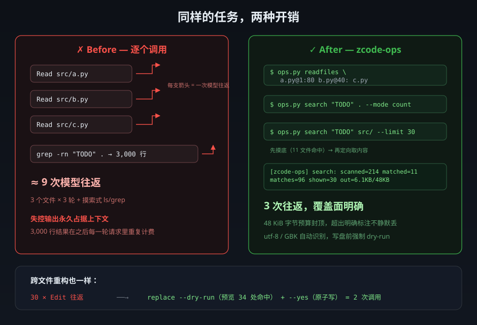

<div align="center">
  
</div>

# zcode-ops

**给 ZCode（及同类 AI 编码助手）用的有界批量文件操作技能。** 一个零依赖的 Python 脚本 + 一份 SKILL.md，把 [T-Auto/dsh-ops](https://github.com/T-Auto/dsh-ops)（MIT）验证过的省 token 思想——**一次调用、有界输出、精确预算**——搬进 ZCode 的技能形态。

核心原则来自 [dsh-ops](https://github.com/T-Auto/dsh-ops) 的实践：AI 操作最贵的不是单个工具执行，而是**工具调用往返次数**和**失控输出对上下文的永久污染**。本技能用四个子命令直接削减这两项开销。

<div align="center">
  
</div>

## 解决什么问题

| 场景 | 原来怎么做（开销） | zcode-ops |
|---|---|---|
| 对照 5 个实现 / 探索新模块 | Read 循环 5–15 次，每轮一个往返 | `readfiles` 1 次 Bash 调用读 1–32 个文件 |
| 搜索命中 3000 行 | 裸 `grep` 全量转储，结果**永久占据上下文，之后每轮重复计费** | `search` count/files 先摸底 → 定向 content，48 KiB 预算封顶 |
| 批量重命名 / 批量替换 | 30 × Edit 往返，或 `sed -i`（中文 Windows 的 GBK 乱码重灾区） | `replace` dry-run + `--yes` 共 2 次调用，逐文件保编码、原子写 |
| 接手陌生项目第一眼 | 反复 `ls` / `find` 试探 | `map` 一次给出目录 + 递归文件数 / 体积 |

## 四个子命令

### `map` — 项目速览

```console
$ python ops.py map .
bench/                                       53 files   613.1 KB   dirs: gates, lib, report, run, …
native/                                      60 files   420.3 KB   dirs: bash-ipc, crates, src, …
src/                                        172 files     1.6 MB   dirs: capabilities, cli, client, …
README.md                                                 9.7 KB
[zcode-ops] map: 573 files, 5.8 MB, 23 top-level entries, elapsed=0.10s
```

### `readfiles` — 一次读多个文件

```console
$ python ops.py readfiles "src/a.py@1:80" "src/b.py@40:" "README.md"
===== src/a.py (enc=utf-8, 512 lines, 18.2 KB) =====
1	def main():
...
----- [1/3] src/a.py: shown 1-80 of 512 lines; continue: src/a.py@81:80 -----
...
[zcode-ops] readfiles: 3/3 files served, out=12.4KB/48.0KB
```

- `path@offset:limit`：起点与条数按物理行（CRLF 算一行），可省略（默认 `1:200`）
- 每文件头标注编码 / 行数 / 字节数；尾部给出**精确续读位置**
- 超预算的文件不会静默丢失——结尾列出待重读清单

### `search` — 有界搜索

```console
$ python ops.py search "TODO" . --mode count --glob "*.py" --glob "!test_*"
src/core.py          14
src/utils.py          6
TOTAL                23
[zcode-ops] search: pattern='TODO' mode=count scanned=214 matched=11 matches=96 shown=0 skipped_binary=2 errors=0 out=758B/48.0KB elapsed=0.03s
```

- 三档模式：`count`（每文件计数 + TOTAL）→ `files`（仅路径）→ `content`（行内容，`--limit` 截断）
- `--glob` 过滤，`!` 前缀排除；默认字面量匹配，`--regex` 切换正则
- summary 行如实汇报覆盖面（含跳过的二进制数、读取错误数）

### `replace` — 跨文件字面量替换

```console
$ python ops.py replace "OldName" "NewName" src --glob "*.py" --dry-run
src/core.py         enc=utf-8   hits=14  | def OldName_handler(request):
[zcode-ops] replace (dry-run): 1 file(s), 34 hit(s), 0 error(s)

$ python ops.py replace "OldName" "NewName" src --glob "*.py" --yes
[zcode-ops] replace done: 12 file(s) changed, 34 replacement(s)
```

- **不带 `--yes` 一律拒绝写盘**（强制先 dry-run 看命中面）
- 逐文件识别编码（utf-8 → GBK），**写盘后编码、BOM、换行符原样保留**；遇未知编码直接拒绝该文件并报告，绝不产生乱码
- 临时文件 + `os.replace` 原子落盘

## 输出契约

- 所有输出默认 **48 KiB 字节预算**（`--budget` 可调），超出**明确标注**，绝不静默截断
- 编码逐文件标注：`utf-8` / `gbk` / `latin-1(lossy)`（latin-1 兜底仅限只读；写操作只接受 utf-8/GBK，防乱码）
- 失败作为值逐项报告（NOT_FOUND / IS_DIR / 读取错误…），不中断整批
- stdout 恒为 UTF-8，管道 / 重定向 / Windows 控制台均无乱码

## 安装

前提：Python ≥ 3.8（零第三方依赖；Windows 自带 Git Bash 的 `python` 即可）。

```bash
git clone https://github.com/lenhui731/zcode-ops.git
mkdir -p ~/.agents/skills
cp -r zcode-ops ~/.agents/skills/
```

ZCode 会自动发现 `~/.agents/skills/` 下的技能（`~/.zcode/skills/` 亦可）。之后凡涉及批量读文件、项目速览、大结果搜索、跨文件替换，模型会按 SKILL.md 的 description 自动触发；也可以手动说"用 zcode-ops 批量读这几个文件"。

手动使用（不装成技能也行）：

```bash
python zcode-ops/scripts/ops.py readfiles src/a.py src/b.py src/c.py
python zcode-ops/scripts/ops.py --help
```

## 收益：如实说明

本仓库**未发布正式 A/B 基准**，以下为机制推算（dsh-ops 上游有自己的 [benchmark](https://github.com/T-Auto/dsh-ops)，结论方向一致，但数字不可直接套用）：

- **往返次数**：批量场景削减 80–95%（10 文件读取 10→1；30 文件替换 30→2）。主要收益来源。
- **墙钟时间**：单轮工具往返（含模型首字延迟）典型 2–30s。按保守 5s/轮，一次 10 文件探索省约 45s；模型繁忙时按比例放大。
- **token**：文件正文不省，省的是每次调用的包装开销 + **被拦截的上下文污染**——一次失控的 grep 转储可达 1–5 万 token，且会话内每轮请求重复计费，会话越长乘数越大。

小任务（读一两个文件、改一处）用内置 Read/Edit 更顺手；任务一旦涉及**多文件、大搜索、批量改**，收益从"省几十秒"跳到"省几分钟 + 会话后半程整体变快"。

## 已知边界

- `search` 每次全量扫描：万级文件毫秒级；更大的仓库先用 `--glob` 收窄
- 默认不遍历 `.git` / `node_modules` / 隐藏目录（`search --hidden` 放开）
- 多行 OLD 在 CRLF 文件中需含 `\r\n`；建议只用单行 OLD
- 单文件精细编辑用内置 Edit；PDF/DOCX 用内置阅读器——本技能刻意不重复造这些轮子

## 致谢与许可

- 设计思想（有界输出、渐进披露、批量合并、失败即值、dry-run 纪律）源自 [T-Auto/dsh-ops](https://github.com/T-Auto/dsh-ops)（MIT），本仓库为其思想在 ZCode 技能形态下的独立 Python 实现，非其代码的衍生分发。
- 本仓库代码以 [MIT](LICENSE) 许可分发。
